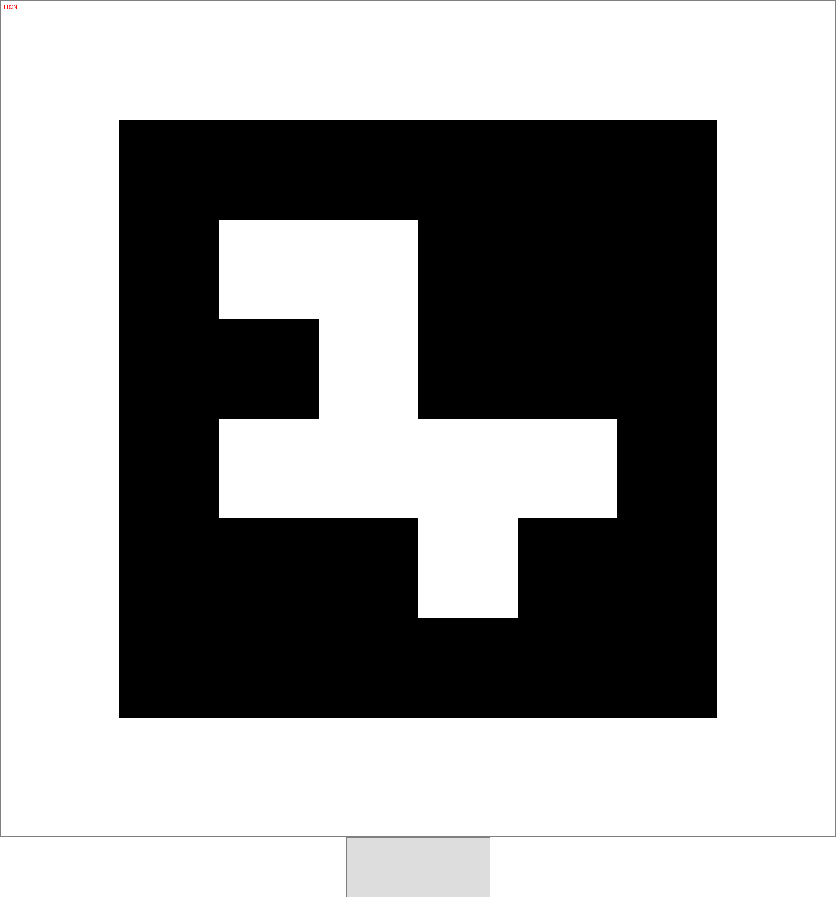
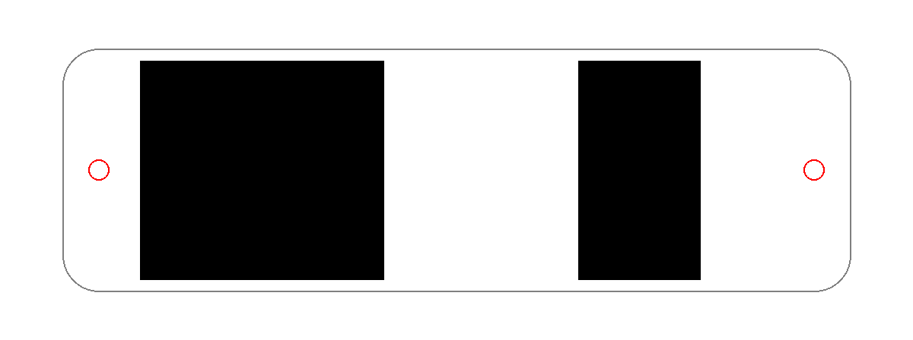
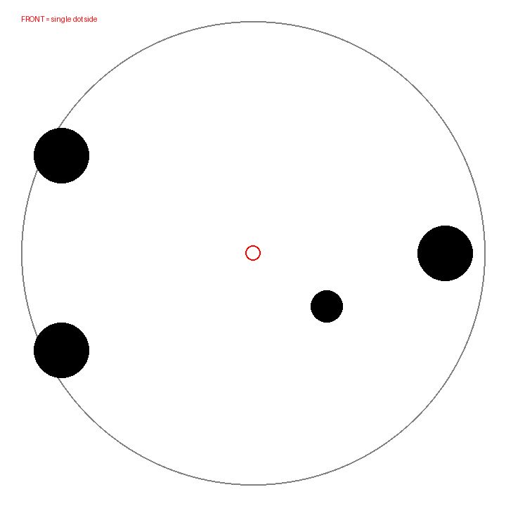
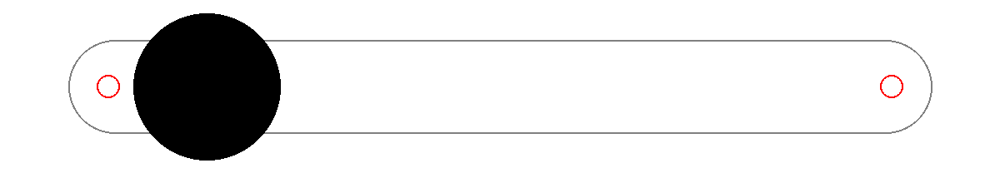
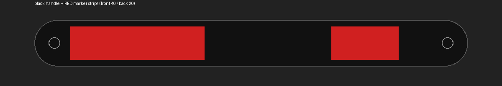
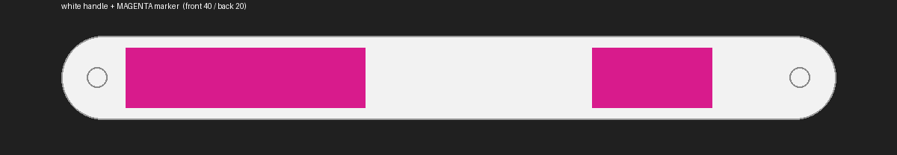

# robot-marker-tag

机器人顶部 **ArUco 顶标**：给外部场地相机同时解算「位置 + 朝向」。
3MF 直接用拓竹（Bambu Studio）打，附 300 dpi PNG（纸贴版）。



## 规格

| 项 | 100 mm 版 | 80 mm 版 |
| --- | --- | --- |
| 字典 / ID | `DICT_4X4_50` / `7` | 同 |
| 模块 | 6 × 6（含 1 模块黑边） | 同 |
| 模块边长 | 16.7 mm | 13.3 mm |
| 底板 | 150 × 150 × 2 mm，圆角 R6 | 130 × 130 × 2 mm |
| 图案凸起 | 0.6 mm | 同 |
| 中心孔 | Ø3.4 mm（M3 通孔） | 同 |
| 静区 | 最窄边 1 个模块 | 同 |
| 方向 | 顶边三角凸片 = 车头 | 同 |

**图案故意偏移半个模块**：这样底板圆心正好落在白色模块中央，Ø3.4 中孔不会切到任何黑模块
（脚本会校验，若换到“中心是黑模块”的 ID 会直接报错）。

## 文件

```text
tag/aruco_4x4_50_id07_100mm.3mf    ← 拓竹直接拖进 Bambu Studio（推荐）
tag/aruco_4x4_50_id07_80mm.3mf
markers/aruco_4x4_50_id07_100mm.png ← 300 dpi，按 100 mm 打印
markers/aruco_4x4_50_id07_80mm.png
markers/manifest.json               ← 字典/ID/尺寸/孔位，解码端直接读
tools/make_tag.py                   ← 重新生成（换 ID / 尺寸 / 孔径）
```

## 打印（Bambu Studio）

1. 把 `.3mf` 拖进去 → 两个零件：`plate`（底板）和 `aruco_pattern`（黑色图案）；
2. 材料：`plate` 白、`aruco_pattern` 黑，双色打印；
3. 参数：PLA / 0.2 mm 层高 / 图案面朝上 / 无支撑；
4. 打之前可以用“按对象”看一下：**三角凸片在 +Y 边**，装配时朝车头。

打出来量一个黑模块：100 mm 版应为 **16.7 mm**，偏差 >0.5 mm 就重打或按比例缩放。

不想双色：只打 `plate`（全白），把 `markers/*.png` 100% 打到哑光相纸裁好贴上去（同样要留静区）。

## 安装

- 中孔 Ø3.4 适合 M3 螺丝：直接穿过底板拧进车顶的 M3 螺纹孔 / 螺母座；平头螺丝更贴合。
- 想用车顶热熔铜螺母（M3 外径约 4.2）：`python tools/make_tag.py --size-mm 100 --hole-mm 4.2` 重新生成。
- 双面胶也可以，但**凸片必须朝车头**，这决定了解码出来的朝向符号。
- 尽量贴在车顶平面、远离线缆遮挡，表面哑光（避免相机高光）。

## 解码（朝向）

```python
d = cv2.aruco.getPredefinedDictionary(cv2.aruco.DICT_4X4_50)
corners, ids, _ = cv2.aruco.ArucoDetector(d, cv2.aruco.DetectorParameters()).detectMarkers(gray)
tl, tr, br, bl = corners[0][0]                 # 标记自身坐标系
marker_x = tr - tl; marker_y = bl - tl
heading_marker_deg = math.degrees(math.atan2(marker_y[1], marker_y[0]))
# 再用 /api/v1/field 的单应矩阵把方向转到场地坐标系
```

OpenCV 返回的角点顺序固定，所以**只要凸片朝车头**，解出的 x 轴方向就是车头方向，不需要试错。

## 多台机器人

换 ID 即可：

```bash
python tools/make_tag.py --id 8 --size-mm 100
python tools/make_tag.py --id 9 --size-mm 100
```

`manifest.json` 会随生成更新，解码端按字典+ID 区分车辆。

## 小空间方案（40 × 40 mm 上限）

**先说结论：40×40 放不下能稳定解码的 ArUco。** 相机当前有效分辨率约 **3.25 px/cm**
（2190 mm 场宽 ≈ 711 px）：

| 特征 | 物理尺寸 | 画面里的大小 | 能不能用 |
| --- | --- | --- | --- |
| ArUco 4×4（6 模块） | 40×40 mm | **13 px** | ❌ 每模块 2 px，解不出 |
| ArUco 4×4 | 80×80 mm | 26 px | ⚠️ 每模块 4.3 px，勉强 |
| ArUco 4×4 | 100×100 mm | 32 px | ✅ 推荐（每模块 5.4 px） |
| 双色长条 | 120×40 mm | 39×13 px | ✅ 两端质心定方向 |

所以 40×40 空间里应该用**不对称长条**，不要用二维码：

### `tag/feature_bar_120x40mm.3mf`（推荐）

- 120×40×2 mm 白板，前端 40×40 黑块、后端 40×20 黑条（凸起 0.6 mm）；
- 方的一端 = 车头，两端尺寸不同所以方向唯一；
- 理论朝向误差 ≈ `atan(0.5px / 19.5px)` ≈ **1.5°**（用两端黑色质心连线）；
- 如果 120 长放不下，可截到 80–100 mm，误差会升到 2–3°。

```bash
python tools/make_feature.py --shape bar     # 已生成，可直接打印
```

### `tag/feature_pad_40x40mm.3mf`（实验性）

- 44×44 板 + 20×20 黑色角三角；
- 40×40 只有 13 px，三角约 6 px，朝向误差 **10–15°**，只能粗定方向；
- 只在完全没空间、又能接受大误差时用。

```bash
python tools/make_feature.py --shape pad
```

> 如果连 120×40 也放不下，建议放弃“用标签定朝向”，改用**走一小段直线 + 相机前后位置差**算方向
> （前面试过，位置精度 1 cm 级，10 cm 位移就能把方向定到 ~5°）。

## 提手一体件（保留原孔位）

`tag/handle_129.5x40mm.3mf`：把提手加宽并兼作朝向标记，**孔位完全按原图**。

| 项 | 值 |
| --- | --- |
| 外形 | 哑铃形：中间握持段 **12 mm 宽**，两端加宽到 40 mm（各长 32.75 mm） |
| 孔位 | 孔距 **117.5 mm**，Ø3.3 通孔，距两端各 6 mm（不变） |
| 倒角 | 上下外缘 0.8 mm（约 45°，不割手） |
| 标记 | 前 20×24 黑块 + 后 12×24 黑块（凸起 0.6 mm，都在加宽垫上） |
| 方向 | **大块那一端 = 车头** |

中间 12 mm 段就是原来的握持宽度（手指能握住），加宽的只是两端放标记的垫子；
两块黑色都避开了 Ø3.3 孔，孔位、孔距完全按原图。



打印：`handle` 白 + `marker` 黑，双色；PLA、0.2mm、无支撑。
装配：沿用原来的两颗螺丝（M3×… 穿过 Ø3.3），大块朝车头。

重新生成：

```bash
python tools/make_handle.py
```

## SSL 风格点阵板（装雷达顶，精度 ≤2°）

按 RoboCup SSL 的做法：圆盘点阵，装在雷达顶部（遮挡最少），用点质心解算位置+朝向。

| 型号 | 板径 | 基线 | 大点/小点 | 960px 下理论朝向误差 |
| --- | --- | --- | --- | --- |
| `ssl_pattern_d110_t60` | 110 mm | **93.9 mm** | Ø13 / Ø7.5 | **1.9°** ✅ |
| `ssl_pattern_d90_t60` | 90 mm | 75.4 mm | Ø11 / Ø6.4 | 2.3°（略超） |

- 布局：底边两各一个点在后（-x），单个大点在前（+x）= 车头，另有一个偏右小点消除 180° 歧义；
- 中心 Ø3.4 通孔（可上 M3 或直接双面胶粘在雷达盖）；
- 板 3 mm 厚，外缘 0.8 mm 倒角；点凸起 0.6 mm（白板黑点，或反色都行）；
- 误差按 3.25 px/cm、质心噪声 0.5 px 估算：**基线每加长 10 mm，误差约降 0.2°**。

> 如果 field-ops 把检测分辨率从 960 提到 1920，上表误差直接减半
> （Ø110 会变成 0.95°，Ø90 变成 1.15°），那样 Ø90 就够用了。



```bash
python tools/make_ssl_pattern.py --diameter 110 --dot-d 13    # 推荐
python tools/make_ssl_pattern.py --diameter 90  --dot-d 11    # 空间紧张
```

## 提手兼标记（长条 + 前端圆钮）

就是现在车上那根“白色细杆 + 白球”的思路，按图纸尺寸做扎实版：

| 项 | 值 |
| --- | --- |
| 条体 | 129.5 × 14 × 6 mm，圆角 R7，上下 0.8 mm 倒角 |
| 孔位 | 孔距 **117.5**、Ø3.3（不变） |
| 圆钮 | Ø22 × 5 mm，位于前端（−44 mm 处），**建议打黑色** |
| 用途 | 条的长轴给朝向（基线 129.5 mm ≈ 42 px → 约 1°），圆钮给方向 |

圆钮放在前端顶面，不改变 129.5 的外形尺寸，也不干涉两个 Ø3.3 孔。
白色条 + 黑色圆钮 → 相机上就是一个细长白条 + 一端一个黑块，方向和轴向都能直接取。



打印：`handle` 白、`front_knob` 黑（双色）；或整体白色、圆钮贴一小片黑色胶带。

## 颜色与 RCJ 规则

RCJ 足球规则明确：**机器人不得使用黄色或蓝色**（避免与球门/场地元素混淆）
——见 [RCJ Soccer Entry Lightweight Rules 2023](https://robofinist.by/files/165547/filename/RoboCupJunior-Soccer-Entry-Lightweight-Rules-2023.pdf)
"Robots are not allowed to be colored yellow or blue in order to avoid interference"。

所以标记色只能从**红 / 白 / 黑 / 其他非黄蓝**里选：

| 配色 | 对比 | 问题 |
| --- | --- | --- |
| 黑底 + **红**标记 | 强（黑/绿/白线都分得开） | 无 ✅ |
| 黑底 + 黄标记 | 强 | **违规** ❌ |
| 黑底 + 黑标记 | 无 | 看不见 ❌ |
| 黑底 + 白标记 | 强 | 易与场地白线抢像素 ⚠️ |

推荐 **黑柄 + 红标记**：

- 前 40×10 红条、后 20×10 红条（凸起 0.3 mm，多色打印第二色）；
- 长轴给朝向（基线 129.5 mm ≈ 42 px，实测主轴噪声 0.1°），前后条长度差给车头方向；
- 9 个针脚孔位不变（孔距 117.5 / Ø3.3）。



> 想要“内嵌”效果（红条与黑面齐平）需要做 0.4 mm 深的凹槽再灌色；
> 凸起 0.3 mm 版本对相机完全等效，打印更省事，先用这个。

## 颜色怎么选（实验室现有耗材）

可用的对比色必须同时远离：**球（橙）**、**场地（绿）**、**白线**、**球门（黄/蓝）**。

| 颜色 | 色相 | 与橙(≈25°)距离 | 与蓝(≈220°)距离 | 评价 |
| --- | --- | --- | --- | --- |
| 品红/洋红 magenta | ≈320° | 远 ✅ | 远 ✅ | **最推荐** |
| 粉 pink | ≈330° | 远 ✅ | 远 ✅ | 可以（比品红淡，阈值要收紧） |
| 紫 purple | ≈280° | 远 ✅ | 偏近 ⚠️ | 暗紫容易读成蓝 |
| 棕 brown | ≈25° | **很近** ❌ | 远 | 和球撞色 |
| 橙 orange | ≈25° | 重合 ❌ | 远 | 绝对不行 |
| 红 red | ≈0° | 近 ⚠️ | 远 | 已被举报过“像橙色” |
| 黄 yellow | ≈55° | 中 | 远 | **RCJ 明文禁止** |
| 白/黑 | 无饱和 | 靠亮度 | — | 白线与白柄会混；黑顶配黑标不可见 |

**结论：白柄 + 品红标记**（或整体品红单色）。黑色柄配粉色确实怪，白色柄配品红最干净：



打印成单色品红也可以——形状（前 40 / 后 20）已经能定方向，颜色只负责让相机把柄从场地里分出来。

## 实拍测色：粉色/红色在这台相机上并不可靠

把粉色耗材放到场上，用 field-ops 相机取样（`reports/field-pink-now.jpg`）：

| 目标 | 采样 RGB | 色相 | 饱和度 |
| --- | --- | --- | --- |
| 粉色料盘 | 亮部 ≈ (200,205,212) | ~305°（弱） | **0.19** |
| 橙色球 | (220,54,74) | 353° | 0.52–0.95 |
| 场地绿 | (19,58,57) 暗部 / (175,220,213) 亮部 | ~170–177° | 0.2–0.7 |

结论：

- 这台相机**色彩很淡**：绿场读数偏青、橙球读数偏红；粉色料盘在画面里**接近白色**（饱和度 0.19）；
- 粉/红/橙三者在相机里挤在一起 → 用色相分割风险大，**红色被举报“像橙色”是有道理的**；
- 场地里除了线缆和阴影**没有黑色物体** → **黑色是这台相机里最不容易混淆的“颜色”**。

所以最终建议：**白柄 + 黑标记**（前 40×10 / 后 20×10），黑色不在 RCJ 禁用列表，也不和球、门、白线撞。
粉色只在**实心、哑光、饱和度高**的打印件上才值得再测；料盘（半透明+反光）不能代表打印效果。
